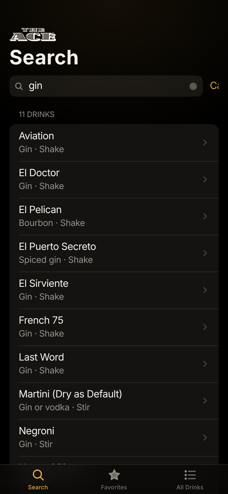
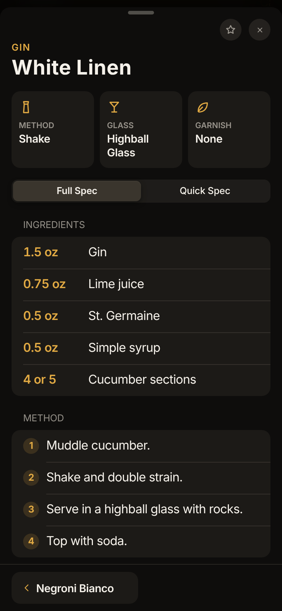

# The Ace · Bartender App

A cocktail spec app for the bar staff at The Ace restaurant. During service a bartender can find any house cocktail in a couple of taps, by name or by ingredient, and see the full spec: ingredients, method, glass and garnish. It's built to feel like a native iPhone app and is meant to be used one-handed behind the bar.

**Live:** https://cholohotsauce.github.io/ace-bartender-app/

<p>
  
  &nbsp;
  
</p>

## Features

- **Search by name or ingredient.** Accent-insensitive and ranked, so "chartreuse" or "mezcal" finds every drink that uses it.
- **Full spec or quick spec.** Each drink opens in a bottom sheet with ingredients split into amounts, numbered steps, and the method (shake or stir) worked out from the instructions.
- **Favorites and recents**, saved on the device with `localStorage`.
- **Touch gestures:** swipe a row to favorite it, press and hold for the quick spec, swipe sideways inside a drink to go to the next one, swipe down to close.
- **All Drinks tab** with an A–Z index rail and filters by spirit.
- 41 house cocktails, stored as typed data in `src/data/cocktails.ts`.

## Tech

TypeScript · Vite · plain DOM (no framework) · CSS · deployed to GitHub Pages

## Run it

```bash
npm ci
npm run dev      # local dev server
npm run build    # type-check and build to dist/
npm run deploy   # publish dist/ to GitHub Pages
```

## What I'd add next

- Let the bar manager add and edit drinks without a code change
- Work fully offline as an installable app
- Tests for the ingredient parser and search ranking
